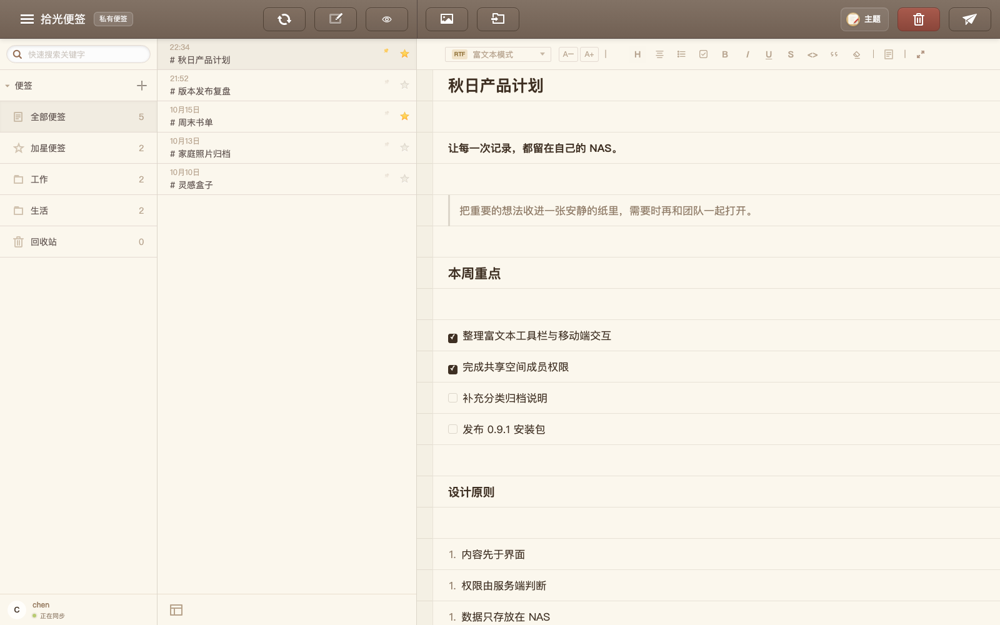
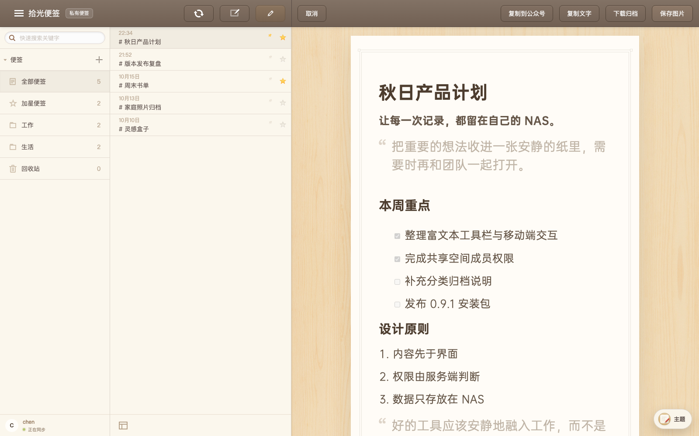
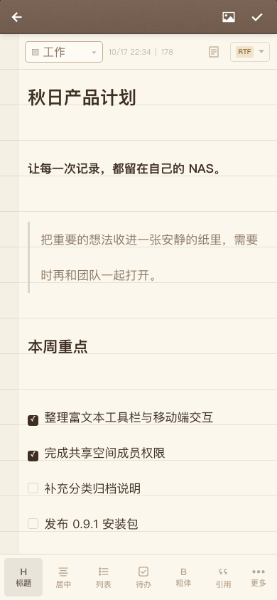
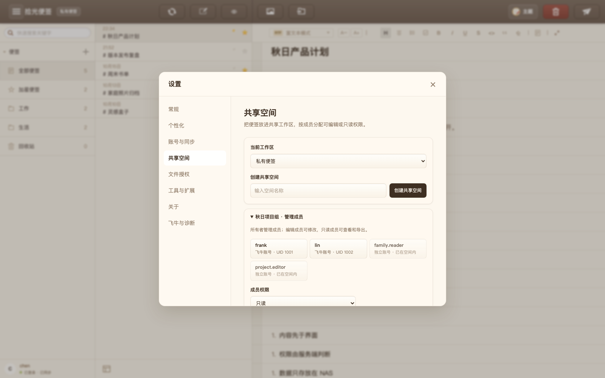
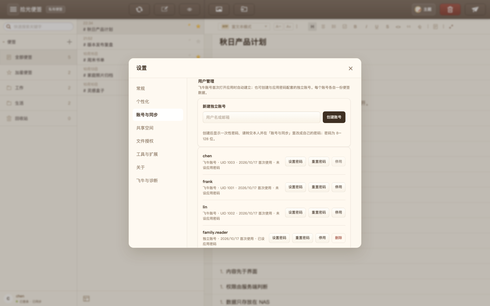
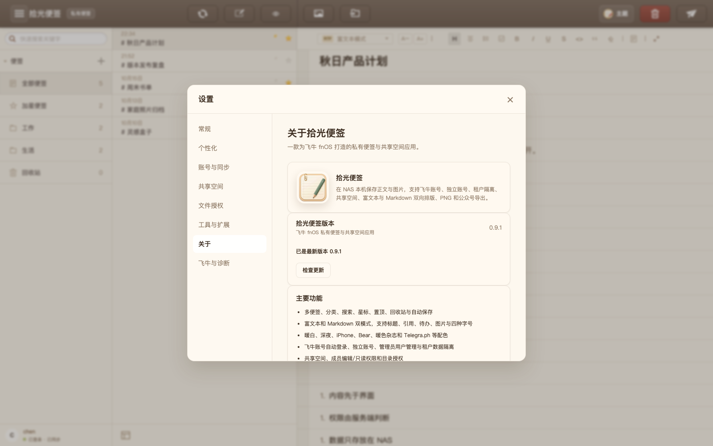
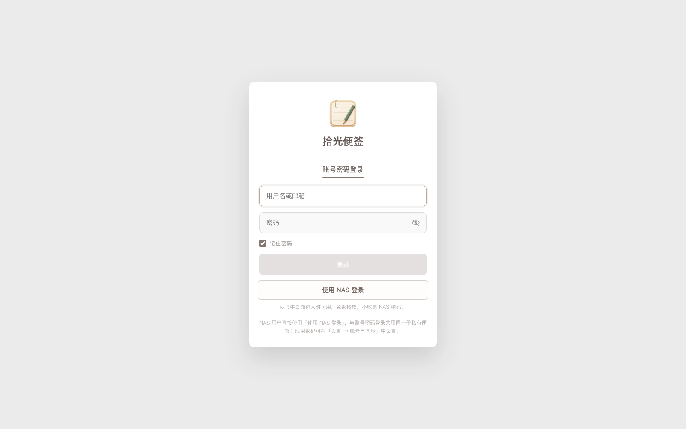

<div align="center">


# 拾光便签

**把想法留在自己的 NAS。**

飞牛 fnOS 上的私有便签、富文本、共享空间与 NAS 文件授权应用。
正文、图片和账号数据保存在本机，适合个人、家庭与小团队长期使用。

[](https://github.com/Alicace/shiguang-notes/releases)
[](https://github.com/Alicace/shiguang-notes/releases)


[](LICENSE)

[下载最新版本](https://github.com/Alicace/shiguang-notes/releases/latest) ·
[查看更新日志](CHANGELOG.md) ·
[问题反馈](https://github.com/Alicace/shiguang-notes/issues)

当前版本：**0.9.5**

</div>



## 一眼看懂

拾光便签保留了安静、专注的纸张式书写体验，并把账号、权限、同步与导出都做成可在 NAS 上独立运行的能力。

- **两种编辑方式**：富文本与 Markdown 随时切换，标题、列表、待办、引用、图片、字号和常用行内格式都可在工具栏完成。
- **自己的数据目录**：便签和图片按账号隔离，保存在飞牛应用数据目录，不经过第三方云笔记服务。
- **真正可管理的账号**：飞牛用户自动建立租户，管理员也能创建独立账号、设置密码、停用或删除账号。
- **可控制的共享空间**：所有者可按已有账号添加成员，分配可编辑或只读权限，并随时撤销。
- **贴近 NAS 的文件能力**：通过飞牛宿主目录选择器授权文件夹，授权记录在刷新、重开应用和切换空间后仍能恢复。
- **从内容到发布**：支持 PNG 长图、公众号富文本、Markdown 工作区 ZIP 和离线 HTML 归档。

## 产品页面

> 以下图片来自开发机模拟租户中的真实页面，用演示便签与演示账号生成，不包含真实用户数据。

### 桌面工作区与富文本

分类、搜索、星标、置顶和便签列表在左侧；标题级别、列表、待办、引用与行内格式在编辑状态栏直接完成。


### 实时预览与排版导出

预览保持纸张排版，字号样式同步到 PNG、公众号和归档；导出入口集中在同一工作区。



<table>
<tr>
<td width="50%" align="center"></td>
<td width="50%" align="center"></td>
</tr>
<tr>
<td align="center"><sub>手机便签列表与分类切换</sub></td>
<td align="center"><sub>手机富文本工具栏与中文说明</sub></td>
</tr>
</table>

### 共享空间

从已有账号直接添加成员，按「可编辑 / 只读」授权；私有便签与共享工作区分别保存。



### 账号与用户管理

管理员可查看飞牛账号和应用独立账号，为其他账号设置密码，并控制停用与删除。普通用户不会看到管理入口。



### 关于、版本与更新

版本检查读取静态清单，不消耗 GitHub API 次数；下载后校验 FPK 大小与 SHA-256，再交给飞牛安装器。



<p align="center">
  
</p>

## 主要能力

| 模块 | 可做的事情 |
| --- | --- |
| 写作与整理 | 多便签、文件夹、搜索、星标、置顶、拖拽排序、回收站、自动保存 |
| 富文本 | 正文 / 标题 1 / 标题 2 / 标题 3、居中、列表、待办、引用、粗体、斜体、下划线、删除线、行内代码、图片块、四种字号、清除格式 |
| Markdown | 实时预览、快捷输入、常用快捷键、表格与代码块渲染、Markdown 与富文本往返 |
| 账号与租户 | 飞牛账号自动登录、独立应用账号、管理员建号、密码设置与重置、停用与删除、数据隔离 |
| 共享协作 | 独立共享空间、成员增删、编辑 / 只读权限、服务端权限校验、私有 / 共享工作区切换 |
| 图片与附件 | 电脑本地导入、NAS 授权目录读取、粘贴截图、拖入图片、裁剪、标注与下载 |
| 目录授权 | 飞牛目录选择器、授权持久化、真实路径检查、读写删权限反馈、NAS 图片路径校验 |
| 导出 | 主题 PNG 长图、公众号富文本、单篇 Markdown 归档、完整工作区 ZIP、离线 HTML |
| 外观 | 暖白纸感、深夜便签、iPhone 浅色 / 深色、Bear、暖色杂志、Telegra.ph |
| 更新 | 静态版本清单、国内下载加速、FPK 体积与 SHA-256 校验、原生安装器衔接 |
| 扩展 | AI 审阅、Workspace API Skill、DeepSeek Harness 插件、公众号与图床配置入口 |

## 安装

1. 从 [Releases](https://github.com/Alicace/shiguang-notes/releases/latest) 下载最新的 x86_64 `.fpk`。
2. 打开飞牛「应用中心 → 手动安装」，选择安装包。
3. 从桌面启动拾光便签，使用 NAS 登录，或输入管理员创建的独立账号。
4. 在「设置 → 文件授权」中授权需要读取图片的 NAS 目录。
5. NAS 管理员可在「设置 → 账号与同步 → 用户管理」创建普通账号。

当前安装包面向 **x86_64** 飞牛设备，应用服务使用 Node.js 22 运行。

## 自动更新

应用读取仓库根目录的公开 [`version.json`](version.json)，不会调用 GitHub Releases API。进入工作区时会自动检查一次，之后可在设置中选择每小时、每 6 小时、每天或每 3 天复查。

发现新版本后会显示可展开的更新内容。版本清单优先从 GitHub 直连、Release 和 Raw 读取，并保留国内加速镜像回退；管理员点击更新后，NAS 会先并发探测 GitHub 直连和多个国内加速镜像，选择实际速度更快的线路，再以后台任务下载。界面实时显示百分比、总大小、当前线路和速度；连接或传输停滞 30 秒会自动切换线路。

下载完成后，服务端检查文件大小、gzip / FPK 头和 SHA-256，通过后写入 NAS 应用数据目录并调起飞牛安装器。新版本进程恢复后页面会自动刷新。

## 数据与安全

- 正文与图片按账号 ID 隔离，不写入浏览器持久缓存。
- 共享空间与目录访问由服务端检查，不能只靠隐藏前端按钮绕过。
- 写操作要求会话、租户绑定与 CSRF 校验。
- 密码连续失败会按「账号 + 来源」退避，降低在线爆破风险。
- 目录与 NAS 图片请求会检查真实路径，拒绝路径穿越和未授权目录。
- 远端图片导入拒绝私网、回环、链路本地和保留地址，并在每次重定向后重新校验。
- 更新包只接受指定 Release 资源和固定加速镜像，并强制校验 SHA-256。
- 应用服务按专用包用户运行；不建议改为 root。

## 本地构建

需要 Node.js 22、飞牛 `fnpack 1.2.3` 与 Linux x86_64 原生运行依赖：

```bash
npm ci
npm test
npm run fnos:build
npm run fnos:pack
```

构建产物为 `fnnotes-m0.fpk`。原生服务、前端、许可证和图标资源会一起写入安装包。

## 问题反馈

请在 [Issues](https://github.com/Alicace/shiguang-notes/issues) 中提供：

- 飞牛版本、拾光便签版本与 NAS 架构；
- 问题发生在飞牛桌面、浏览器还是手机；
- 可复现的点击步骤和预期结果；
- 不含密码、Token、隐私正文与完整 NAS 路径的错误信息。

## 感谢与许可

感谢 [zhaoolee/notes](https://github.com/zhaoolee/notes) 与所有开源贡献者的早期工作。拾光便签在此基础上完成了飞牛原生封装和大量功能扩展；项目依据 [Apache License 2.0](LICENSE) 发布，原始版权与 [NOTICE](NOTICE) 声明继续保留。

本项目与飞牛官方无隶属关系。第三方主题、字体、图标和商标仍归各自权利人所有。
